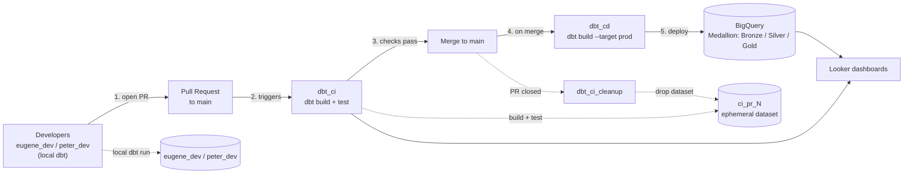
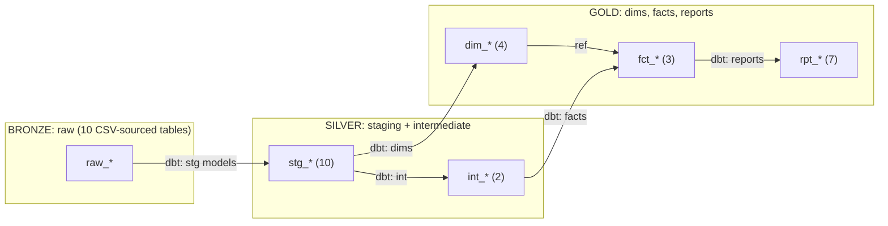

# Healthcare Analytics: Dimensional Modelling on BigQuery

An end-to-end analytics engineering project that turns raw healthcare CSV extracts into a tested, documented dimensional model in **Google BigQuery**, using **dbt** for transformation, **GitHub Actions** for CI/CD, and **Looker** for visualization.

The warehouse follows the **Medallion Architecture** (Bronze → Silver → Gold), implemented as custom schemas inside BigQuery. The project was built collaboratively by two developers through a GitHub pull-request workflow.

---

## Table of Contents

1. [Project Overview](#project-overview)
2. [Tech Stack](#tech-stack)
3. [Architecture](#architecture)
4. [Data Model (Medallion Layers)](#data-model-medallion-layers)
5. [Business Questions Answered (Reports)](#business-questions-answered-reports)
6. [CI/CD Pipeline](#cicd-pipeline)
7. [Environments and GCP Projects](#environments-and-gcp-projects)
8. [Authentication (OIDC / Workload Identity Federation)](#authentication-oidc--workload-identity-federation)
9. [Collaboration Workflow](#collaboration-workflow)
10. [Getting Started (Local Development)](#getting-started-local-development)
11. [Repository Structure](#repository-structure)
12. [Running in a Fork](#running-in-a-fork)
13. [Contributors](#contributors)

---

## Project Overview

Healthcare organizations generate data across many disconnected systems: patients, encounters, diagnoses, procedures, claims, payers, providers, and departments. This project consolidates ten raw source tables into a clean dimensional model that supports operational and financial reporting.

**Goals**

- Load raw CSV source data into BigQuery as the Bronze layer.
- Clean, standardize, and join the data in the Silver layer (staging and intermediate models).
- Publish analytics-ready dimensions, facts, and report tables in the Gold layer.
- Automatically test and deploy every change with GitHub Actions, so `main` is always production-ready.
- Serve the Gold layer to Looker dashboards.

---

## Tech Stack

| Concern | Tool |
|---|---|
| Data warehouse | Google BigQuery |
| Transformation and testing | dbt (project: `healthcare_analysis`) |
| Data visualization | Looker |
| CI/CD | GitHub Actions (separate CI and CD runners) |
| Cloud authentication | OIDC via GCP Workload Identity Federation |
| Source data | CSV files (10 raw tables) |
| Version control and collaboration | GitHub (pull requests into `main`) |

---

## Architecture


> Save the architecture diagram as `docs/architecture.png` so the image above renders.

### High-level flow



### Data lineage



---

## Data Model (Medallion Layers)

The medallion layers are overlaid on BigQuery using **custom schemas**, so each layer lives in its own dataset and access and lineage stay clear.

### 🥉 Bronze: raw tables (dbt sources)

Ten raw tables loaded directly from the source CSV files. No transformations are applied; they are declared as dbt **sources**.

| Table | Description |
|---|---|
| `raw_claims` | Insurance claims submitted for encounters |
| `raw_departments` | Hospital departments |
| `raw_diagnosis_codes` | Diagnosis code reference data |
| `raw_encounter_diagnoses` | Diagnoses linked to encounters |
| `raw_encounter_procedures` | Procedures linked to encounters |
| `raw_encounters` | Patient visits / admissions |
| `raw_patients` | Patient demographics |
| `raw_payers` | Insurance payers |
| `raw_procedures` | Procedure reference data |
| `raw_providers` | Clinicians / providers |

### 🥈 Silver: staging and intermediate

**Staging (`stg_*`, 10 models):** one staging model per raw table (`stg_raw_claims`, `stg_raw_departments`, `stg_raw_diagnosis_codes`, `stg_raw_encounter_diagnoses`, `stg_raw_encounter_procedures`, `stg_raw_encounters`, `stg_raw_patients`, `stg_raw_payers`, `stg_raw_procedures`, `stg_raw_providers`). These rename columns, cast data types, and standardize values.

**Intermediate (`int_*`, 2 models):** reusable business logic that joins staging models.

| Model | Purpose |
|---|---|
| `int_all_encounters` | Consolidated encounter-level dataset |
| `int_encounter_diagnoses` | Encounters enriched with their diagnoses |

### 🥇 Gold: dimensions, facts, and reports

**Dimensions (`dim_*`, 4 models)**

| Model | Description |
|---|---|
| `dim_raw_departments` | Department dimension |
| `dim_raw_patients` | Patient dimension |
| `dim_raw_payers` | Payer dimension |
| `dim_raw_providers` | Provider dimension |

**Facts (`fct_*`, 3 models)**

| Model | Description |
|---|---|
| `fct_all_encounters` | Encounter-grain fact table |
| `fct_encounter_diagnoses` | Encounter-to-diagnosis fact table |
| `fct_raw_claims` | Claims fact table |

**Reports (`rpt_*`, 7 models)**: see the next section.

---

## Business Questions Answered (Reports)

Each `rpt_*` model in the Gold layer answers a specific business question and feeds Looker.

| Report model | Question it answers |
|---|---|
| `rpt_average_length_of_stay` | How long do patients stay, on average? |
| `rpt_denial_rate_by_payer_and_department` | What share of claims is denied, by payer and department? |
| `rpt_most_denial_reasons` | What are the most common reasons for claim denial? |
| `rpt_operational_volumes` | What are the encounter and operational volumes? |
| `rpt_paid_revenue_by_encounter_per_department` | How much paid revenue does each department generate per encounter? |
| `rpt_payer_reimbursement` | How much does each payer reimburse? |
| `rpt_procedure_patterns` | Which procedures are most common, and what are the patterns? |

> The questions above are derived from the model names. Refine the wording to match the exact business questions you defined for the project.

---

## CI/CD Pipeline

The project uses **three GitHub Actions workflows**, with **separate runners for CI and CD**, so validation and deployment are isolated from each other.

| Workflow | Trigger | What it does |
|---|---|---|
| **`dbt_ci`** | Pull request opened or updated against `main` | Runs `dbt build` + tests against an ephemeral dataset `ci_pr_<N>` in the CI project |
| **`dbt_ci_cleanup`** | Pull request closed | Drops the `ci_pr_<N>` dataset so no CI artifacts are left behind |
| **`dbt_cd`** | Merge (push) to `main`, or manual run | Runs `dbt build --target prod` to deploy to production |

### Step-by-step

1. **Open PR:** a developer opens a pull request into `main` after developing locally.
2. **Triggers CI:** `dbt_ci` starts automatically on the CI runner.
3. **Checks pass:** models are built and tested in an isolated, per-PR dataset (for example `ci_pr_18`). The PR can only be merged when checks pass.
4. **On merge:** merging into `main` triggers `dbt_cd` on the CD runner.
5. **Deploy:** `dbt build --target prod` builds the Bronze → Silver → Gold models in the production project.
6. **Cleanup:** when the PR closes, `dbt_ci_cleanup` drops the ephemeral CI dataset.

---

## Environments and GCP Projects

Two separate GCP projects keep CI activity fully isolated from production data.

| Environment | GCP project | Datasets | Purpose |
|---|---|---|---|
| **Local / dev** | `healthcare-analytics-510014` | `eugene_dev`, `peter_dev` | Each developer's personal sandbox for local `dbt run` |
| **CI** | `healthcare-analytics-ci` | `ci_pr_<N>` (ephemeral, one per PR) | Build and test PR changes; dropped when the PR closes |
| **Production** | `healthcare-analytics-510014` | Medallion layers (Bronze / Silver / Gold) | Merged `main`; the source for Looker |

---

## Authentication (OIDC / Workload Identity Federation)

GitHub Actions authenticates to Google Cloud with **OpenID Connect (OIDC)** through a **Workload Identity Federation** pool (`github-actions-pool`). This means:

- **No long-lived service account keys** are stored in GitHub secrets.
- Short-lived credentials are issued per workflow run.
- Access can be restricted to a specific repository and branch.

---

## Collaboration Workflow

This was a team project on GitHub, built by two developers (`eugene_dev` and `peter_dev`).

1. Create a feature branch from `main`.
2. Develop and test locally with dbt against your personal dev dataset.
3. Open a pull request into `main`.
4. Wait for the `dbt_ci` checks to pass; address any failures.
5. Request a review and merge.
6. `dbt_cd` deploys to production automatically.

---

## Getting Started (Local Development)

### Prerequisites

- Python 3.9+ and `pip`
- `dbt-bigquery`
- Access to the GCP project (`gcloud` CLI installed)
- A BigQuery dataset for your own dev work (for example `<your_name>_dev`)

### Setup

```bash
# 1. Clone the repository
git clone https://github.com/<owner>/Healthcare-Analytics.git
cd Healthcare-Analytics

# 2. Install dbt for BigQuery
pip install dbt-bigquery

# 3. Authenticate to Google Cloud
gcloud auth application-default login

# 4. Configure your dbt profile (see below), then verify the connection
dbt debug
```

### Example `~/.dbt/profiles.yml`

```yaml
healthcare_analysis:
  target: dev
  outputs:
    dev:
      type: bigquery
      method: oauth
      project: healthcare-analytics-510014
      dataset: <your_name>_dev        # e.g. eugene_dev or peter_dev
      threads: 4
      location: <your_bq_location>
```

### Common commands

```bash
dbt deps                 # install packages
dbt build                # run models + tests
dbt build --select +fct_all_encounters   # build a model and its upstream dependencies
dbt test                 # run tests only
dbt docs generate && dbt docs serve      # browse model docs and lineage
```

---

## Repository Structure

> Adjust to match your actual folder layout.

```
Healthcare-Analytics/
├── .github/
│   └── workflows/
│       ├── dbt_ci.yml            # PR validation on the CI runner
│       ├── dbt_ci_cleanup.yml    # drops ci_pr_<N> when the PR closes
│       └── dbt_cd.yml            # deploys to prod on merge
├── models/
│   ├── staging/                  # stg_* (Silver)
│   ├── intermediate/             # int_* (Silver)
│   └── marts/                    # dim_*, fct_*, rpt_* (Gold)
├── seeds/ or data/               # source CSV files (Bronze input)
├── tests/
├── docs/
│   └── architecture.png
├── dbt_project.yml
└── README.md
```

---

## Running in a Fork

If you fork this repository, the GitHub Actions workflows will **not** work out of the box:

- **Secrets and variables are not copied to forks.** Add your own under *Settings → Secrets and variables → Actions* (GCP project IDs, Workload Identity provider, service account, etc.).
- **Workload Identity Federation is tied to the original repository.** Create your own pool and provider that trusts your fork, or CD authentication will fail.
- **Scheduled and some triggered workflows are disabled on forks.** Enable them from the **Actions** tab.
- Check workflow files for conditions such as `if: github.repository == '<original-owner>/Healthcare-Analytics'`, which skip jobs in forks.

---

## Contributors

| Developer | Role |
|---|---|
| `eugene_dev` (EUG1N3) | Developer |
| `peter_dev` (petermuriya) | Developer |

---

## License

Add your license here (for example MIT).
